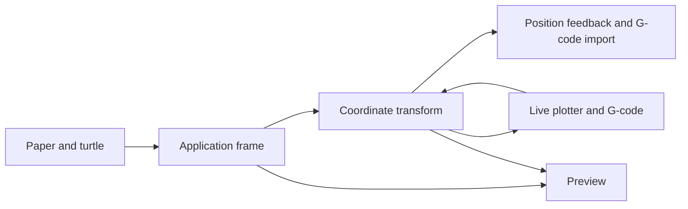

# Requirements

### Outcome
Use the existing nine-position setting to identify where the firmware already considers `(0, 0)`, using the active paper's outer edges—not machine limits or drawing margins. Drawings stay in their existing application coordinate system and physical placement; live commands and exported G-code use firmware coordinates.

- Keep the firmware’s configuration, homing commands, and user-written G-code unchanged; selecting an origin does not re-zero the machine.
- Preserve unchanged coordinates for the center position when the active paper is centered; include its configured center offset when it is shifted.
- Show the selected machine origin in the preview. The cursor tooltip shows labeled application and machine coordinates in different colors.
- Treat the selected position as a declaration that must match firmware configuration; document the risk of a mismatch.

# Technical Design

### Coordinate contract
Add a reusable transform alongside `PlotterSettings`. Map `StartingPosition` indices in their existing order to the left/middle/right and top/middle/bottom points of the active paper's outer edges, adding the paper's center offset to the edge coordinates. Ignore drawing margins and machine limits. For selected point `O` in application coordinates:

- Absolute machine position = application position − `O`; inverse = machine position + `O`.
- Distances, relative moves, pen/Z commands, and axes directions are unchanged. Validate the origin index and finite, positive paper dimensions; reject invalid configurations rather than silently sending incorrectly offset motion.

### Integration
- Keep `Paper`, `Turtle`, generators such as `Generator_Border`, converters such as `TransformedImage`, and `ProgramPanel` in their current application frame. Do not translate artwork or non-G-code formats.
- In `MarlinPlotterPanel.sendGoto()`, transform the application-frame `Plotter` position once before formatting generated XY commands. Convert `M114` feedback back before updating `Plotter`; introduce a feedback-only position update so a report does not emit another motion command. Preserve partial-axis values in machine coordinates and leave state unchanged on malformed reports.
- In `SaveGCode`, apply the same transform to generated travel/draw coordinates and `MINX`, `MINY`, `MAXX`, and `MAXY` comments. Ensure generated XY moves use absolute positioning even if user snippets change mode; do not rewrite user snippets. Apply the same absolute-mode protection to live generated moves.
- For G-code imported through the active application profile, add a profile-aware `LoadGCode`/`TurtleFactory` route that converts parsed machine-frame geometry back to application coordinates. Preserve the existing profile-free `TurtleFactory.load(String)` behavior for callers without settings; do not change other formats. Preserve relative-motion and arc behavior by transforming resolved geometry rather than treating deltas as absolute coordinates.
- `Plotter.findHome()` currently assumes `PlotterSettings.getHome()` is `(0,0)`; homing is not necessarily the selected origin. Do not infer the physical home from the origin. Keep the configured homing command and use a valid position report to update the displayed position; do not fabricate a confirmed position when home is unknown.
- Keep one consistent coordinate transform for the duration of a live job: prevent profile, paper dimension/placement, or origin changes from changing its frame until the job and queued commands finish.
- Update `Polargraph.paintOrigin()` to draw the selected machine zero in the existing world frame. Pass current settings from `PreviewPanel` to `RenderPanel` for an HTML tooltip with labeled, differently colored application and machine coordinates; refresh after profile changes.

### Architecture

### Compatibility and safety
The center position uses the paper's actual center, including any paper offset, and remains unchanged by machine-limit changes. Document the selected-origin/firmware alignment requirement. Configured start, end, home, pen, and tool-change G-code is passed through unchanged and remains the user's responsibility.

# Testing

### Automated validation
- Unit-test all nine paper-edge mappings, inverse round trips, shifted paper, margin and machine-limit independence, and invalid paper dimensions/settings.
- Extend `SaveGCodeTest` and `SaveAndLoadGCodeTest` for transformed moves and bounds, profile-aware round trips, profile-free loading, relative moves, arc geometry, and user snippets that change positioning mode.
- Extend `MarlinPlotterInterfaceTest` to check transformed live moves, inverse `M114` feedback without a new move, partial/malformed reports, homing behavior, and stable origin during a job.
- Exercise origin-marker and tooltip calculations, settings changes, and representative generator/converter output without hardware.
- Run targeted JUnit tests followed by the Maven test suite where the environment permits.

# Delivery Steps

### ✓ Step 1: Define paper-origin transform
A validated coordinate transform maps each existing starting position to the active paper's outer edges.

- Update the reusable transform to derive origin points from paper dimensions and center offset, using the existing `StartingPosition` ordering.
- Preserve application geometry, ignore paper margins and machine limits, and implement inverse conversion.
- Add JUnit coverage for all nine origins, shifted paper, independence from margins and machine limits, round trips, and invalid settings.

### ✓ Step 2: Apply origin to live plotter communication
Live commands and position reports use matching coordinate frames without generating feedback moves.

- Update `MarlinPlotterPanel` and `Plotter` to transform generated XY moves and inverse-transform `M114` reports.
- Protect generated absolute moves from user-defined positioning modes and preserve configured homing behavior without assuming home equals origin.
- Keep the active job’s transform stable until queued commands finish, and add communication and safety tests.

### ✓ Step 3: Apply origin to G-code interchange
Exported drawing coordinates match the firmware origin and profile-aware imports return to the application frame.

- Update `SaveGCode` moves and bounds while preserving user-authored snippets.
- Add profile-aware G-code loading through `TurtleFactory` while retaining the existing profile-free API and other format behavior.
- Extend G-code tests for frame round trips, relative motion, arcs, bounds, and absolute-mode handling.

### ✓ Step 4: Expose coordinate frames in preview
The preview identifies the selected machine origin and displays both cursor coordinate systems.

- Update `Polargraph.paintOrigin()`, `PreviewPanel`, and `RenderPanel` to use current settings and render a labeled two-color tooltip.
- Document firmware alignment, paper-center offset behavior, and user-supplied G-code responsibilities.
- Add preview and representative art-generation regression coverage, then run the relevant Maven tests.